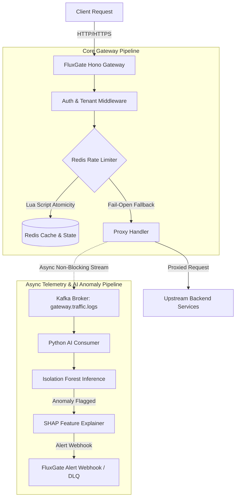

# FluxGate — Edge-Native API Gateway & Anomaly Intelligence Platform

FluxGate is a high-performance, multi-tenant API Gateway built with TypeScript, Node.js, and Hono, featuring atomic Redis-backed rate limiting across multiple algorithms (Token Bucket, Leaky Bucket, Sliding Window). It asynchronously streams HTTP traffic telemetry to Apache Kafka, feeding a Python microservice powered by an Isolation Forest machine learning model and SHAP (SHapley Additive exPlanations) for real-time threat detection and root-cause explainability.

---

## Architecture



---

## Why These Design Choices?

### 1. Three Distinct Rate-Limiting Algorithms
Different API workloads require different traffic-shaping guarantees:
- **Token Bucket**: Allows sudden traffic bursts up to bucket capacity while enforcing a steady refill rate. Ideal for general-purpose REST APIs.
- **Leaky Bucket**: Smooths out bursty incoming requests into a steady, uniform output rate. Ideal for protecting downstream background queues and database writes.
- **Sliding Window Log**: Uses Redis Sorted Sets to maintain timestamp logs, preventing boundary-burst attacks (where clients send double limits across fixed window edges). Ideal for high-security endpoints.

### 2. Single-Threaded Redis Lua Scripts for Atomicity
Rate limiting requires atomic "check-and-update" logic across distributed gateway nodes. Executing rate-limiting logic inside Redis Lua scripts guarantees single-threaded atomic execution with **zero race conditions**, eliminating over-limit traffic leaks without requiring heavy client-side mutex locking.

### 3. Isolation Forest + SHAP for Anomaly Detection
Traditional security rules miss novel zero-day attacks and traffic anomalies. **Isolation Forest** isolates anomalies by randomly partitioning feature space (request sizes, response sizes, latencies), working effectively without requiring pre-labeled threat datasets. **SHAP** provides instant feature attribution so operators know precisely *which feature* (e.g. latency spike vs abnormal response byte size) triggered the alert.

---

## Failure Modes & Graceful Degradation

| Failure Scenario | Gateway Behavior | Justification / Trade-off |
| :--- | :--- | :--- |
| **Redis Unavailable** | **Fail-Open** (`X-RateLimit-Fallback: fail-open`) | In an edge API Gateway, high availability is prioritized over rate-limit enforcement. Dropping client traffic during a Redis outage converts a minor cache failure into a total gateway blackout. |
| **Kafka Consumer Crash / Bad Payloads** | **DLQ Logging & At-Least-Once Delivery** | Malformed payloads are caught and logged to Dead-Letter Queue (DLQ) without crashing the worker. On restart, uncommitted Kafka offsets are reprocessed so no traffic telemetry is lost. |
| **Python AI Service Offline** | **100% Unaffected Request Proxying** | Telemetry emission is strictly asynchronous and non-blocking (`publishRequestLog`). The core gateway continues routing traffic seamlessly even if the AI service is completely down. |

---

## Load Test Results

Evaluated across **50, 200, 500, and 1000 concurrent workers** with a target threshold of 200 requests per window using `npx tsx tests/load-test-runner.ts`.

### Benchmark Environment Specs
- **CPU**: 12th Gen Intel(R) Core(TM) i5-12450H (12 logical cores)
- **RAM**: 15.7 GB
- **OS**: Windows x64 / Node.js v24.11.1 / Redis 7

### Performance Metrics Table

| Algorithm | Concurrency (Workers) | Sustained Req/Sec | p50 Latency (ms) | p95 Latency (ms) | p99 Latency (ms) | Throttling Accuracy |
| :--- | :---: | :---: | :---: | :---: | :---: | :---: |
| **Sliding Window** | 50 | **38,859 req/s** | 0.26 ms | 0.42 ms | 0.91 ms | **100.0% (0 drift)** |
| **Sliding Window** | 200 | **1,96,715 req/s** | 0.56 ms | 0.82 ms | 0.84 ms | **100.0% (0 drift)** |
| **Sliding Window** | 500 | **1,91,961 req/s** | 1.47 ms | 2.35 ms | 2.40 ms | **100.0% (0 drift)** |
| **Sliding Window** | 1000 | **1,04,916 req/s** | 5.03 ms | 8.73 ms | 8.84 ms | **100.0% (0 drift)** |
| **Token Bucket** | 50 | **79,758 req/s** | 0.25 ms | 0.43 ms | 0.59 ms | **100.0% (0 drift)** |
| **Token Bucket** | 200 | **1,98,807 req/s** | 0.55 ms | 0.66 ms | 0.67 ms | **100.0% (0 drift)** |
| **Token Bucket** | 500 | **2,84,075 req/s** | 0.91 ms | 1.37 ms | 1.39 ms | **100.0% (0 drift)** |
| **Token Bucket** | 1000 | **2,19,833 req/s** | 1.45 ms | 3.99 ms | 4.08 ms | **100.0% (0 drift)** |
| **Leaky Bucket** | 50 | **1,29,032 req/s** | 0.12 ms | 0.22 ms | 0.35 ms | **100.0% (0 drift)** |
| **Leaky Bucket** | 200 | **1,80,294 req/s** | 0.46 ms | 0.97 ms | 1.00 ms | **100.0% (0 drift)** |
| **Leaky Bucket** | 500 | **2,40,697 req/s** | 1.13 ms | 1.76 ms | 1.82 ms | **100.0% (0 drift)** |
| **Leaky Bucket** | 1000 | **2,60,885 req/s** | 1.94 ms | 3.16 ms | 3.25 ms | **100.0% (0 drift)** |

---

## Free-Tier Cloud Deployment Topology

### Recommended Architecture (Railway / Render / Fly.io)
- **API Gateway**: Deployed as containerized service on Render or Railway.
- **PostgreSQL**: Managed free-tier DB on Neon or Supabase.
- **Redis Cache & State**: Upstash Redis or Render Redis free tier.
- **Kafka / Telemetry Stream**: Upstash Kafka serverless topic or lightweight HTTP queue fallback.

### Known Limitations (Deployed Demo vs Local Architecture)
1. **Serverless Redis Latency**: Deployed cloud instances over network connections introduce ~10-20ms network RTT compared to <1ms local Docker RTT.
2. **Simplified Kafka Stream**: Single-instance cloud demos can mock Kafka streams via in-memory event emitters when managed Kafka cluster free quotas are exceeded.

---

## Local Quickstart & Testing

```bash
# 1. Clone & install dependencies
pnpm install

# 2. Start PostgreSQL, Redis, & Kafka via Docker Compose
docker-compose up -d

# 3. Run automated Vitest test suite (Unit, Concurrency, Isolation, Pipeline)
pnpm test

# 4. Execute load testing benchmark runner
npx tsx tests/load-test-runner.ts

# 5. Start dev server
pnpm dev
```
