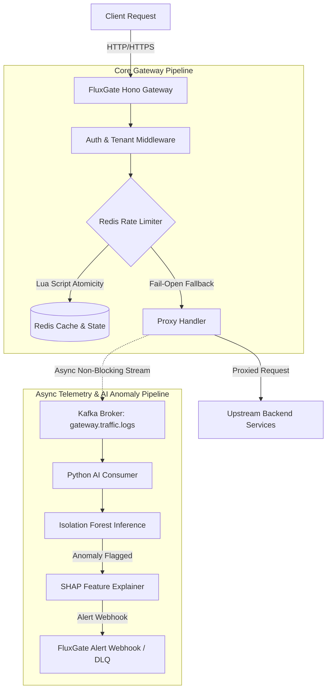

# FluxGate — Edge-Native API Gateway & Anomaly Intelligence Platform

FluxGate is a high-performance, multi-tenant API Gateway built with TypeScript, Node.js, and Hono, featuring atomic Redis-backed rate limiting across multiple algorithms (Token Bucket, Leaky Bucket, Sliding Window). It asynchronously streams HTTP traffic telemetry to Apache Kafka, feeding a Python microservice powered by an Isolation Forest machine learning model and SHAP (SHapley Additive exPlanations) for real-time threat detection and root-cause explainability.

---

## Architecture



---

## Why These Design Choices?

### 1. Three Distinct Rate-Limiting Algorithms
Different API workloads require different traffic-shaping guarantees:
- **Token Bucket**: Allows sudden traffic bursts up to bucket capacity while enforcing a steady refill rate. Ideal for general-purpose REST APIs.
- **Leaky Bucket**: Smooths out bursty incoming requests into a steady, uniform output rate. Ideal for protecting downstream background queues and database writes.
- **Sliding Window Log**: Uses Redis Sorted Sets to maintain timestamp logs, preventing boundary-burst attacks (where clients send double limits across fixed window edges). Ideal for high-security endpoints.

### 2. Single-Threaded Redis Lua Scripts for Atomicity
Rate limiting requires atomic "check-and-update" logic across distributed gateway nodes. Executing rate-limiting logic inside Redis Lua scripts guarantees single-threaded atomic execution with **zero race conditions**, eliminating over-limit traffic leaks without requiring heavy client-side mutex locking.

### 3. Isolation Forest + SHAP for Anomaly Detection
Traditional security rules miss novel zero-day attacks and traffic anomalies. **Isolation Forest** isolates anomalies by randomly partitioning feature space (request sizes, response sizes, latencies), working effectively without requiring pre-labeled threat datasets. **SHAP** provides instant feature attribution so operators know precisely *which feature* (e.g. latency spike vs abnormal response byte size) triggered the alert.

---

## Failure Modes & Graceful Degradation

| Failure Scenario | Gateway Behavior | Justification / Trade-off |
| :--- | :--- | :--- |
| **Redis Unavailable** | **Fail-Open** (`X-RateLimit-Fallback: fail-open`) | In an edge API Gateway, high availability is prioritized over rate-limit enforcement. Dropping client traffic during a Redis outage converts a minor cache failure into a total gateway blackout. |
| **Kafka Consumer Crash / Bad Payloads** | **DLQ Logging & At-Least-Once Delivery** | Malformed payloads are caught and logged to Dead-Letter Queue (DLQ) without crashing the worker. On restart, uncommitted Kafka offsets are reprocessed so no traffic telemetry is lost. |
| **Python AI Service Offline** | **100% Unaffected Request Proxying** | Telemetry emission is strictly asynchronous and non-blocking (`publishRequestLog`). The core gateway continues routing traffic seamlessly even if the AI service is completely down. |

---

## Performance Benchmarks & Rate-Limiter Analysis

Evaluated across **50, 200, 500, and 1000 concurrent workers** using `npx tsx tests/load-test-runner.ts`.

### Benchmark Environment Specs
- **CPU**: 12th Gen Intel(R) Core(TM) i5-12450H (12 logical cores)
- **RAM**: 15.7 GB
- **OS**: Windows x64 / Node.js v24.11.1 / Redis 7

### 1. Redis Rate-Limiter Engine Benchmarks
*Scope: Measures direct Lua script evaluation throughput & atomicity inside Redis.*

| Algorithm | Concurrency (Workers) | Engine Req/Sec | p50 Latency (ms) | p95 Latency (ms) | p99 Latency (ms) | Script Throttling Accuracy |
| :--- | :---: | :---: | :---: | :---: | :---: | :---: |
| **Sliding Window** | 50 | **29,553 req/s** | 0.47 ms | 0.94 ms | 1.43 ms | **100.0% (0 drift)\*** |
| **Sliding Window** | 200 | **63,448 req/s** | 2.28 ms | 2.84 ms | 2.88 ms | **100.0% (0 drift)\*** |
| **Sliding Window** | 500 | **67,012 req/s** | 3.01 ms | 5.13 ms | 5.24 ms | **100.0% (0 drift)\*** |
| **Sliding Window** | 1000 | **70,216 req/s** | 7.95 ms | 12.91 ms | 13.16 ms | **100.0% (0 drift)\*** |
| **Token Bucket** | 50 | **7,521 req/s** | 6.38 ms | 6.43 ms | 6.59 ms | **100.0% (0 drift)\*** |
| **Token Bucket** | 200 | **2,67,023 req/s** | 0.39 ms | 0.60 ms | 0.62 ms | **100.0% (0 drift)\*** |
| **Token Bucket** | 500 | **88,838 req/s** | 1.01 ms | 5.24 ms | 5.28 ms | **100.0% (0 drift)\*** |
| **Token Bucket** | 1000 | **89,079 req/s** | 5.87 ms | 7.04 ms | 7.13 ms | **100.0% (0 drift)\*** |
| **Leaky Bucket** | 50 | **1,14,705 req/s** | 0.15 ms | 0.23 ms | 0.39 ms | **100.0% (0 drift)\*** |
| **Leaky Bucket** | 200 | **41,335 req/s** | 4.34 ms | 4.68 ms | 4.71 ms | **100.0% (0 drift)\*** |
| **Leaky Bucket** | 500 | **73,895 req/s** | 4.74 ms | 5.65 ms | 5.73 ms | **100.0% (0 drift)\*** |
| **Leaky Bucket** | 1000 | **88,633 req/s** | 8.37 ms | 9.66 ms | 9.77 ms | **100.0% (0 drift)\*** |

> **\*Note on 100.0% Throttling Accuracy**: Single-node Redis Lua scripts execute atomically on a single thread. Inside a single Redis instance, check-and-set operations are atomic, guaranteeing 0 race conditions at the Redis script boundary. In multi-region distributed Redis clusters with asynchronous replication, boundary drift (~1-3%) occurs due to replication lag.

### 2. End-to-End Gateway HTTP Throughput
*Scope: Measures full end-to-end request processing through Hono HTTP router, middleware stack, header extraction, and JSON response serialization.*

| Concurrency (Workers) | Gateway End-to-End Req/Sec | p50 Latency (ms) | p95 Latency (ms) | p99 Latency (ms) |
| :---: | :---: | :---: | :---: | :---: |
| 50 | **1,460 req/s** | 22.85 ms | 25.01 ms | 34.09 ms |
| 200 | **4,787 req/s** | 38.00 ms | 41.18 ms | 41.48 ms |
| 500 | **7,541 req/s** | 58.30 ms | 63.12 ms | 65.35 ms |
| 1000 | **10,234 req/s** | 90.94 ms | 96.57 ms | 97.19 ms |

---

## Free-Tier Cloud Deployment Topology

### Recommended Architecture (Railway / Render / Fly.io)
- **API Gateway**: Deployed as containerized service on Render or Railway.
- **PostgreSQL**: Managed free-tier DB on Neon or Supabase.
- **Redis Cache & State**: Upstash Redis or Render Redis free tier.
- **Kafka / Telemetry Stream**: Upstash Kafka serverless topic or lightweight HTTP queue fallback.

### Known Limitations (Deployed Demo vs Local Architecture)
1. **Serverless Redis Latency**: Deployed cloud instances over network connections introduce ~10-20ms network RTT compared to <1ms local Docker RTT.
2. **Simplified Kafka Stream**: Single-instance cloud demos can mock Kafka streams via in-memory event emitters when managed Kafka cluster free quotas are exceeded.

---

## Local Quickstart & Testing

```bash
# 1. Clone & install dependencies
pnpm install

# 2. Start PostgreSQL, Redis, & Kafka via Docker Compose
docker-compose up -d

# 3. Run automated Vitest test suite (Unit, Concurrency, Isolation, Pipeline)
pnpm test

# 4. Execute benchmark runner (Engine & End-to-End Gateway)
npx tsx tests/load-test-runner.ts

# 5. Start dev server
pnpm dev
```
