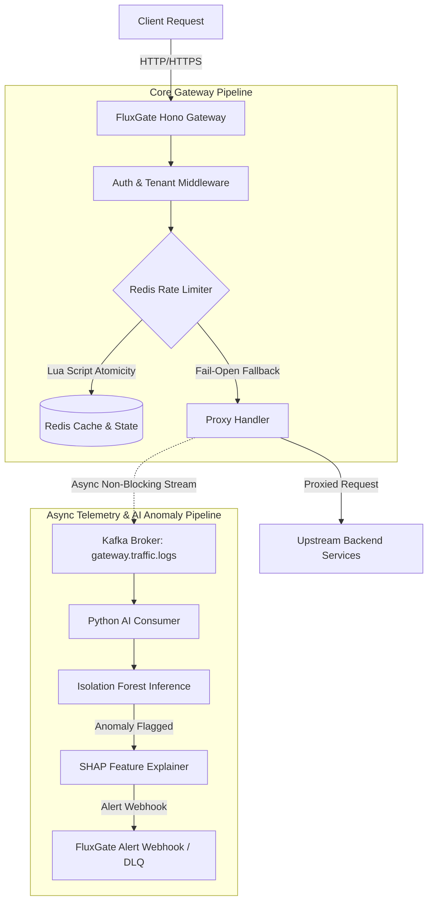

# FluxGate — Edge-Native API Gateway & Anomaly Intelligence Platform

FluxGate is a high-performance, multi-tenant API Gateway built with TypeScript, Node.js, and Hono, featuring atomic Redis-backed rate limiting across multiple algorithms (Token Bucket, Leaky Bucket, Sliding Window). It asynchronously streams HTTP traffic telemetry to Apache Kafka, feeding a Python microservice powered by an Isolation Forest machine learning model and SHAP (SHapley Additive exPlanations) for real-time threat detection and root-cause explainability.

---

## Architecture



---

## Why These Design Choices?

### 1. Three Distinct Rate-Limiting Algorithms
Different API workloads require different traffic-shaping guarantees:
- **Token Bucket**: Allows sudden traffic bursts up to bucket capacity while enforcing a steady refill rate. Ideal for general-purpose REST APIs.
- **Leaky Bucket**: Smooths out bursty incoming requests into a steady, uniform output rate. Ideal for protecting downstream background queues and database writes.
- **Sliding Window Log**: Uses Redis Sorted Sets to maintain timestamp logs, preventing boundary-burst attacks (where clients send double limits across fixed window edges). Ideal for high-security endpoints.

### 2. Single-Threaded Redis Lua Scripts for Atomicity
Rate limiting requires atomic "check-and-update" logic across distributed gateway nodes. Executing rate-limiting logic inside Redis Lua scripts guarantees single-threaded atomic execution with **zero race conditions**, eliminating over-limit traffic leaks without requiring heavy client-side mutex locking.

### 3. Isolation Forest + SHAP for Anomaly Detection
Traditional security rules miss novel zero-day attacks and traffic anomalies. **Isolation Forest** isolates anomalies by randomly partitioning feature space (request sizes, response sizes, latencies), working effectively without requiring pre-labeled threat datasets. **SHAP** provides instant feature attribution so operators know precisely *which feature* (e.g. latency spike vs abnormal response byte size) triggered the alert.

---

## Failure Modes & Graceful Degradation

| Failure Scenario | Gateway Behavior | Justification / Trade-off |
| :--- | :--- | :--- |
| **Redis Unavailable** | **Fail-Open** (`X-RateLimit-Fallback: fail-open`) | In an edge API Gateway, high availability is prioritized over rate-limit enforcement. Dropping client traffic during a Redis outage converts a minor cache failure into a total gateway blackout. |
| **Kafka Consumer Crash / Bad Payloads** | **DLQ Logging & At-Least-Once Delivery** | Malformed payloads are caught and logged to Dead-Letter Queue (DLQ) without crashing the worker. On restart, uncommitted Kafka offsets are reprocessed so no traffic telemetry is lost. |
| **Python AI Service Offline** | **100% Unaffected Request Proxying** | Telemetry emission is strictly asynchronous and non-blocking (`publishRequestLog`). The core gateway continues routing traffic seamlessly even if the AI service is completely down. |

---

## Benchmarks

The numbers previously published here came from a harness that could silently fall back to an in-memory mock of Redis, and whose "end-to-end" section only requested `/health`. They have been removed. To produce real numbers, with Postgres, Redis and Redpanda running and k6 installed:

```bash
pnpm bench
```

It writes `docs/benchmarks/results.md`, and aborts instead of reporting if a dependency is down or the gateway degrades during the run.

---

## Free-Tier Cloud Deployment Topology

### Recommended Architecture (Railway / Render / Fly.io)
- **API Gateway**: Deployed as containerized service on Render or Railway.
- **PostgreSQL**: Managed free-tier DB on Neon or Supabase.
- **Redis Cache & State**: Upstash Redis or Render Redis free tier.
- **Kafka / Telemetry Stream**: Upstash Kafka serverless topic or lightweight HTTP queue fallback.

### Known Limitations (Deployed Demo vs Local Architecture)
1. **Serverless Redis Latency**: Deployed cloud instances over network connections introduce ~10-20ms network RTT compared to <1ms local Docker RTT.
2. **Simplified Kafka Stream**: Single-instance cloud demos can mock Kafka streams via in-memory event emitters when managed Kafka cluster free quotas are exceeded.

---

## Local Quickstart & Testing

```bash
pnpm install

# Postgres, Redis and Redpanda
docker compose up -d --wait postgres redis redpanda

# Unit tests, no services needed
pnpm test

# Against real Postgres and Redis; refuses any database that is not local and *_test
pnpm test:integration

# Real processes: gateway, Kafka, Python consumer, alert, webhook
pnpm test:e2e

# Create the schema, then start the gateway
pnpm db:migrate
pnpm dev
```
